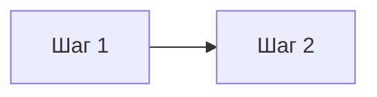

# Модуль N · Название

> Как создать модуль: скопируйте папку `_template/` в `mNN-name/` (латиница и дефисы),
> переименуйте `solutions/mNN_name.py` в соответствии с именем папки (дефис → подчёркивание).
> Удалите эти подсказки.

## Что это и зачем

1–2 предложения простыми словами: что изучаем и где это встречается в жизни.

## 📖 Теория карточками

### 🃏 Идея (≤ 80 слов, метафора или игра)
Текст.



### 🃏 Как это в коде
Короткий пример.

## ✍️ Задания

Правьте `exercises.py`, запускайте `pytest mNN-name`.

**Задание 1. `function_name`.** Что нужно сделать.

<details><summary>💡 Подсказка 1</summary>Направление мысли.</details>
<details><summary>💡💡 Подсказка 2</summary>Намёк.</details>
<details><summary>💡💡💡 Подсказка 3</summary>Почти ответ.</details>

## 🏁 Покажи, что получилось

```bash
python mNN-name/demo.py
```

## 🧠 А знаете?

Проверенный факт. Источник: [название](https://example.org).
