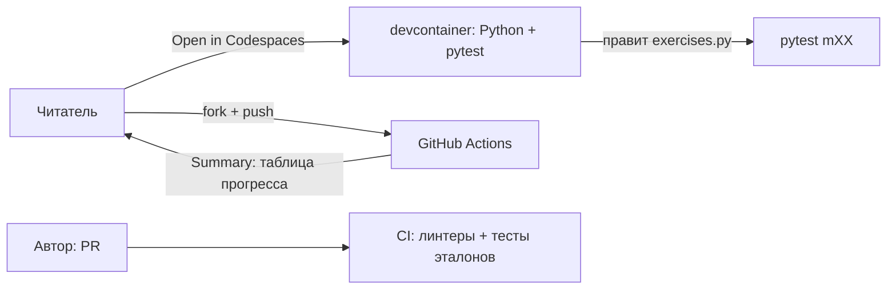

# Техническая документация

Версия 0.2 · 2026-11-10 · концепция: репозиторий + средства GitHub, без сайта и приложения

## 1. Обзор

Репозиторий — набор модулей. Читатель работает в **Codespaces** (браузерный VS Code с Python) или локально.
Проверка решений — **pytest**. Автоматизация — **GitHub Actions**. Приложения и сервера нет.



## 2. Стек

| Что | Выбор | Почему |
|---|---|---|
| Язык | Python 3.11+ | цель проекта |
| Тесты | pytest | проверка заданий |
| Линтер и формат | Ruff (заменяет Flake8 и Black) | один инструмент |
| Типы | Mypy на `solutions/` | показать type hints |
| Графики | matplotlib | как в практических работах |
| Диаграммы | Mermaid в Markdown | рендерит GitHub |
| Окружение | `pyproject.toml`, venv, devcontainer | воспроизводимость |
| Хуки | pre-commit (ruff, mypy) | чистая история |
| CI | GitHub Actions | бесплатно |
| Зависимости | Dependabot | безопасность |

## 3. Структура

```
/
├─ README.md  LICENSE  CONTRIBUTING.md  CHANGELOG.md
├─ pyproject.toml  .pre-commit-config.yaml  .gitignore
├─ .devcontainer/devcontainer.json
├─ .github/
│   ├─ workflows/ ci.yml, my-progress.yml
│   ├─ ISSUE_TEMPLATE/ task_error.yml, task_idea.yml
│   ├─ PULL_REQUEST_TEMPLATE.md
│   └─ dependabot.yml
├─ docs/  (REQUIREMENTS, CONTENT_MAP, ARCHITECTURE, BACKLOG, SCRUM_PLAN, GLOSSARY)
├─ tools/ progress.py, check_template.py
├─ conftest.py
├─ assets/ (графики из demo.py)
├─ _template/  (шаблон модуля)
├─ _template_bonus/  (шаблон бонус-модуля)
├─ bonus/  (бонус-модули bNN-name, появятся с v1.1; см. BONUS_MAP.md)
└─ m01-search/ … m08-graphs/
    ├─ README.md  exercises.py  test_exercises.py  demo.py
    └─ solutions/
```

## 4. Переключение «упражнения / решения»

`conftest.py` читает переменную `PRACTICUM_TARGET`:

| Значение | Что импортируют тесты | Где используется |
|---|---|---|
| `exercises` (по умолчанию) | `mXX/exercises.py` | читатель, форк |
| `solutions` | `mXX/solutions/…` | CI автора |

Тест подгружает нужный модуль через фикстуру `target`. Заготовки в `exercises.py` бросают `NotImplementedError`; `conftest` превращает это в статус **«ещё не сделано»** (`skip` с причиной), а не в падение.

## 5. Формат тестов (для читателя)

- Имена вида `test_binary_search_returns_minus_one_when_missing` читаются как предложение.
- Крайние случаи в `@pytest.mark.parametrize`: пустой список, один элемент, дубликаты, отсутствующий ключ.
- Сообщения через `assert got == expected, "подсказка: …"`.
- Тип «проверка сложности»: список-обёртка считает обращения к элементам, лимит `≤ log₂(n)+2`.
- Задание «найди ошибку»: `exercises.py` содержит готовый код с ошибкой, тест падает до исправления (маркер `bugfix`: в режиме `exercises` падение считается «ещё не сделано»).
- Задание-рефакторинг (бонус b02): код уже работает, тест проверяет **форму** (например, число `if` через `ast`) и **неизменность поведения**; маркер `refactor` работает так же, как `bugfix`. Такой тест всегда один на задание, чтобы частично пройденные проверки не считались решением.
- Тесты не зависят от времени выполнения и случайности (фиксированный `seed`).

## 6. Автоматизация (GitHub Actions)

**`ci.yml`** (PR и push в `main`):
1. `ruff check` и `ruff format --check`.
2. `mypy` для `solutions/`.
3. `pytest` с `PRACTICUM_TARGET=solutions` — все должны **пройти**.
4. `pytest` с `exercises` — все должны быть `skip`/«не сделано» (защита от случайно оставленных решений).
5. `tools/check_template.py`: у каждого модуля есть README, ≥ 3 подсказки у каждого задания, факт и источник.

**`my-progress.yml`** (для форков; `workflow_dispatch` и push):
запускает `pytest` для `exercises`, `tools/progress.py` собирает таблицу и пишет в `$GITHUB_STEP_SUMMARY`:

| Модуль | Выполнено | Не сделано | Падает |
|---|---|---|---|
| m01-search | 5 / 6 | 1 | 0 |

Права `contents: read` минимальные. Файлы репозитория workflow не меняет.

## 7. Шаблон модуля

`_template/README.md` содержит разделы: «Что это» · «Зачем» · «Карточки» (≤ 80 слов) · схема Mermaid · «Задания» (с `<details>` для подсказок) · «А знаете?» (с источником) · «Запуск».
Подсказки:

```markdown
**Задание 2. Напиши `binary_search`**
<details><summary>💡 Подсказка 1</summary>Нужны две границы: левая и правая.</details>
<details><summary>💡💡 Подсказка 2</summary>Смотрим в середину и отбрасываем половину.</details>
<details><summary>💡💡💡 Подсказка 3</summary>Если середина меньше цели — `left = mid + 1`.</details>
```

## 8. Codespaces

`devcontainer.json`: образ Python 3.12, установка `pip install -e .[dev]`, расширения VS Code (Python, Ruff), команда `pytest` по умолчанию. Бейдж «Open in Codespaces» в README. Запасной вариант: `python -m venv .venv && pip install -e .[dev]`.

## 9. Качество

- Ruff, Mypy, type hints и docstrings обязательны в `solutions/`.
- Conventional Commits, ветки `feat/…`, `content/…`, `fix/…`, merge через PR.
- SemVer, теги релизов, `CHANGELOG.md`.
- Безопасность: нет секретов; Dependabot; минимальные права в Actions; код читателя исполняется только в его среде.

## 10. Решения (ADR)

| ID | Решение | Статус |
|---|---|---|
| ADR-001 | Только репозиторий и средства GitHub, без сайта | Принято |
| ADR-002 | pytest как механизм проверки заданий | Принято |
| ADR-003 | Решения в `solutions/`, подсказки в `<details>` | Принято |
| ADR-004 | Ruff вместо Black+Flake8 | Принято |
| ADR-005 | Название репозитория | Отложено |
| ADR-006 | Jupyter-ноутбуки | Не делаем в v1.0 |
