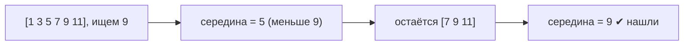

# Модуль 1 · Поиск

> Незнакомое слово? Загляните в [глоссарий](../docs/GLOSSARY.md).

## Что это и зачем

Поиск — самая частая задача в программировании: найти контакт, товар, слово. Здесь мы сравним два способа:
**линейный** (смотрим всё подряд) и **бинарный** (каждый раз отбрасываем половину).

## 📖 Теория карточками

### 🃏 Линейный поиск
Идём по списку и спрашиваем: «Это оно?». Нашли — вернули индекс. Не нашли до конца — вернули `-1`.
Для 1000 элементов в худшем случае 1000 проверок. Это **O(n)**: время растёт вместе со списком.

### 🃏 Игра «Угадайка»
Я загадал число от 1 до 100. Вы называете 50. Я говорю «больше». Теперь 75. «Меньше». Так за 7 ходов вы всегда угадаете.
Это и есть бинарный поиск.

### 🃏 Бинарный поиск
Работает **только в отсортированном списке**. Берём середину; если она меньше цели — ищем справа, больше — слева.
Каждый шаг отбрасывает половину, поэтому для 1 000 000 элементов нужно около 20 шагов. Это **O(log n)**.



### 🃏 Что значит O(n) и O(log n)?
Это «как растёт время, когда растёт список». O(n) — растёт так же. O(log n) — почти не растёт.

## ✍️ Задания

Правьте `exercises.py`, запускайте `pytest m01-search`. Пока в заготовке `raise NotImplementedError`, тест показывает «ещё не сделано».

**Задание 1. `linear_search`.** Верните индекс первого совпадения или `-1`.

<details><summary>💡 Подсказка 1</summary>Нужен цикл по элементам списка.</details>
<details><summary>💡💡 Подсказка 2</summary>`for index, value in enumerate(items):` даёт сразу индекс и значение.</details>
<details><summary>💡💡💡 Подсказка 3</summary>Если `value == target` — сделайте `return index`. После цикла — `return -1`.</details>

**Задание 2. `next_bounds`.** Один шаг бинарного поиска: куда сдвинуть границы?

<details><summary>💡 Подсказка 1</summary>Если элемент в середине меньше цели, то всё, что слева от середины, нам уже не нужно.</details>
<details><summary>💡💡 Подсказка 2</summary>Меньше цели → ищем справа, иначе слева.</details>
<details><summary>💡💡💡 Подсказка 3</summary>Справа: `(mid + 1, right)`. Слева: `(left, mid - 1)`.</details>

**Задание 3. `binary_search`.** Соберите всё вместе. Заодно тест проверит, что вы смотрите в список не более `log₂(n) + 2` раз.

<details><summary>💡 Подсказка 1</summary>Нужны две границы: `left` и `right`. С чего они начинаются?</details>
<details><summary>💡💡 Подсказка 2</summary>Пока `left <= right` — смотрим в середину `(left + right) // 2`.</details>
<details><summary>💡💡💡 Подсказка 3</summary>Прочитайте `items[mid]` один раз в переменную: каждое обращение тест считает.</details>

**Задание 4. «Найди ошибку».** Функция `contains` уже написана, но иногда врёт. Найдите ошибку и исправьте.

<details><summary>💡 Подсказка 1</summary>Ошибка проявляется на крайних случаях: список из одного элемента, последний элемент.</details>
<details><summary>💡💡 Подсказка 2</summary>Посмотрите на условие цикла: что происходит, когда `left == right`?</details>
<details><summary>💡💡💡 Подсказка 3</summary>Условие должно быть `left <= right`, а не `left < right`.</details>

**Задание 5. Предскажи вывод (без запуска).** Сколько максимум шагов нужно бинарному поиску для списка из 1024 элементов?

<details><summary>Ответ</summary>11 шагов: 2¹⁰ = 1024, плюс последний шаг. Линейному поиску в худшем случае нужно 1024.</details>

## 🏁 Покажи, что получилось

```bash
python m01-search/demo.py
```

Выведет таблицу времени (а с matplotlib — ещё и график в `assets/`).

## 🧠 А знаете?

Двадцати вопросов «да/нет» хватает, чтобы различить больше миллиона вариантов: 2²⁰ = 1 048 576.
Поэтому в игре «Угадай число» двадцать ходов достаточно для числа до миллиона.
Подробнее: [Binary search algorithm](https://en.wikipedia.org/wiki/Binary_search_algorithm).
