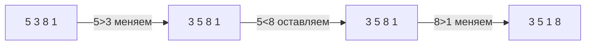

# Модуль 2 · Простые сортировки

> Незнакомое слово? Загляните в [глоссарий](../docs/GLOSSARY.md).

## Что это и зачем

Отсортированные данные искать и сравнивать проще (помните бинарный поиск из модуля 1?).
Здесь мы разберём три простых способа сортировки. Они медленные на больших списках, зато понятные.

## 📖 Теория карточками

### 🃏 Пузырёк: «газировка»
Идём по списку и сравниваем соседей. Если левый больше правого, меняем их местами.
Самое большое число «всплывает» в конец, как пузырёк в стакане. После каждого прохода одно число встаёт на своё место.
Если за проход не было ни одного обмена, список уже готов, можно остановиться.



### 🃏 Выбор: «найди самого маленького»
Ищем минимальный элемент во всём списке и ставим его первым. Потом ищем минимум среди оставшихся и ставим вторым. И так до конца.

### 🃏 Вставки: «карты в руке»
Берём карты по одной и вставляем в нужное место среди тех, что уже лежат по порядку. Левая часть всегда отсортирована.

### 🃏 Почему это O(n²)?
В каждой сортировке есть цикл внутри цикла. Список в 2 раза длиннее значит в 4 раза больше работы.
Запустите `demo.py` и увидите это своими глазами.

## ✍️ Задания

Правьте `exercises.py`, запускайте `pytest m02-simple-sorts`. Пока в заготовке `raise NotImplementedError`, тест показывает «ещё не сделано». Все функции должны возвращать **новый** список и не менять исходный.

**Задание 1. `bubble_sort`.** Сортировка пузырьком с ранним выходом.

<details><summary>💡 Подсказка 1</summary>Нужен цикл внутри цикла. Внутренний сравнивает соседей, внешний повторяет проходы.</details>
<details><summary>💡💡 Подсказка 2</summary>С каждым проходом хвост списка уже отсортирован, поэтому внутренний цикл можно укорачивать: `range(n - i - 1)`.</details>
<details><summary>💡💡💡 Подсказка 3</summary>Заведите флаг `swapped = False` перед проходом и ставьте `True` при обмене. Если после прохода он `False` — `break`.</details>

**Задание 2. `find_min_index` и `selection_sort`.** Сначала найдите индекс минимума, потом соберите сортировку.

<details><summary>💡 Подсказка 1</summary>Запомните индекс лучшего кандидата `best = start` и сравнивайте с каждым следующим.</details>
<details><summary>💡💡 Подсказка 2</summary>Если `items[j] < items[best]`, то `best = j`. Меняйте только при строгом «меньше», тогда при равных останется первый.</details>
<details><summary>💡💡💡 Подсказка 3</summary>В `selection_sort`: для каждого `i` найдите `m = find_min_index(result, i)` и обменяйте `result[i]` с `result[m]`.</details>

**Задание 3. `insertion_sort`.** Сортировка вставками.

<details><summary>💡 Подсказка 1</summary>Начните со второго элемента: первый один уже «отсортирован».</details>
<details><summary>💡💡 Подсказка 2</summary>Возьмите `key = result[i]` и сдвигайте вправо всё, что больше `key`, пока не найдёте место.</details>
<details><summary>💡💡💡 Подсказка 3</summary>`while j >= 0 and result[j] > key:` сдвиг `result[j + 1] = result[j]`, `j -= 1`. После цикла `result[j + 1] = key`.</details>

**Задание 4. «Найди ошибку».** Функция `sort_cards` уже написана, но иногда возвращает неотсортированный список. Исправьте её.

<details><summary>💡 Подсказка 1</summary>Попробуйте на списке из двух элементов `[2, 1]`.</details>
<details><summary>💡💡 Подсказка 2</summary>Какой элемент никогда не сравнивается с `key`?</details>
<details><summary>💡💡💡 Подсказка 3</summary>Условие цикла `while j > 0` пропускает нулевой элемент. Должно быть `j >= 0`.</details>

**Задание 5. Предскажи вывод (без запуска).** Что получится после **первого прохода** пузырька по списку `[5, 3, 8, 1]`?

<details><summary>Ответ</summary>`[3, 5, 1, 8]`. Сначала 5 и 3 меняются, 5 и 8 остаются, 8 и 1 меняются. Самое большое число уже в конце.</details>

## 🏁 Покажи, что получилось

```bash
python m02-simple-sorts/demo.py
```

Выведет таблицу времени трёх сортировок (а с matplotlib ещё и график в `assets/`).

## 🧠 А знаете?

`sorted()` и `list.sort()` в Python устроены не так, как наши простые сортировки.
Тим Петерс написал для Python алгоритм Timsort в 2002 году, а в новых версиях (с 3.11) правило слияния в нём заменили на Powersort.
Для почти отсортированных списков они работают очень быстро.
Подробнее: [Timsort](https://en.wikipedia.org/wiki/Timsort), [от QuickSort к Powersort](https://in.pycon.org/cfp/2024/proposals/from-quicksort-to-timsort-to-powersort-unveiling-the-evolution-of-cpythons-sorting-algorithm~e73pj/).
