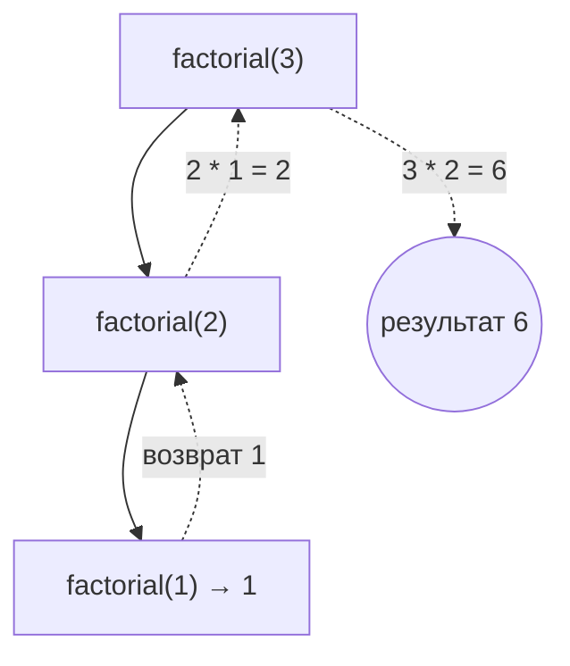

# Модуль 3 · Рекурсия и стек

## Что это и зачем

Рекурсия — когда функция вызывает саму себя, чтобы решить задачу поменьше.
Стек — стопка, в которой берут только верхний элемент. Они связаны: когда функция вызывает функцию, Python складывает вызовы в такую стопку.
Рекурсия нужна для деревьев, графов и быстрых сортировок, которые впереди.

## 📖 Теория карточками

### 🃏 Матрёшка
Открываем матрёшку, а внутри такая же, только поменьше. Так до самой маленькой, которую уже не открыть.
Рекурсия работает так же: задача делится на такую же задачу поменьше, пока не станет совсем простой.

### 🃏 Два обязательных правила
1. **Базовый случай:** когда пора остановиться (например, `0! = 1`).
2. **Рекурсивный случай:** шаг к базовому (`n! = n * (n-1)!`).

Нет базового случая значит функция не остановится: `RecursionError`.

```python
def factorial(n):
    if n <= 1:  # базовый случай
        return 1
    return n * factorial(n - 1)  # рекурсивный случай
```

### 🃏 Стек: стопка тарелок
Тарелку кладут сверху и берут тоже сверху. Последняя положенная уходит первой (**LIFO**).
Операции: `push` (положить), `pop` (снять), `peek` (посмотреть), `is_empty` (пусто ли).



### 🃏 Рекурсия и стек вызовов
Каждый вызов функции кладётся в стек вызовов. Когда функция возвращает значение, её вызов снимается.
Поэтому глубина рекурсии ограничена. Запустите `demo.py`, чтобы увидеть предел.

## ✍️ Задания

Правьте `exercises.py`, запускайте `pytest m03-recursion-stack`. Пока в заготовке `raise NotImplementedError`, тест показывает «ещё не сделано».

**Задание 1. `factorial`.** Факториал рекурсивно, для отрицательных чисел `ValueError`.

<details><summary>💡 Подсказка 1</summary>Сначала проверьте отрицательное `n`, потом базовый случай.</details>
<details><summary>💡💡 Подсказка 2</summary>Для `n` равного 0 или 1 ответ 1, дальше рекурсия не нужна.</details>
<details><summary>💡💡💡 Подсказка 3</summary>`return n * factorial(n - 1)`.</details>

**Задание 2. `recursive_sum`.** Сумма списка без циклов и без `sum()`.

<details><summary>💡 Подсказка 1</summary>Чему равна сумма пустого списка? Это ваш базовый случай.</details>
<details><summary>💡💡 Подсказка 2</summary>Сумма списка — это первый элемент плюс сумма всех остальных.</details>
<details><summary>💡💡💡 Подсказка 3</summary>«Все остальные» — это срез `items[1:]`.</details>

**Задание 3. `binary_search_rec`.** Рекурсивный бинарный поиск (помните модуль 1?).

<details><summary>💡 Подсказка 1</summary>Базовых случая два: «искать негде» и «нашли».</details>
<details><summary>💡💡 Подсказка 2</summary>Если `left > right`, элемента нет: `-1`. Если `right` не задан, возьмите `len(items) - 1`.</details>
<details><summary>💡💡💡 Подсказка 3</summary>Середина меньше цели — вызовите функцию с `mid + 1` и `right`, больше — с `left` и `mid - 1`.</details>

**Задание 4. `Stack`.** Класс стека на основе списка.

<details><summary>💡 Подсказка 1</summary>В `__init__` создайте пустой список `self._items = []`. Подчёркивание сообщает: это внутреннее.</details>
<details><summary>💡💡 Подсказка 2</summary>`push` — это `append`, `pop` — это `list.pop()`. `is_empty` и `__len__` опираются на длину списка.</details>
<details><summary>💡💡💡 Подсказка 3</summary>В `pop` и `peek` сначала проверьте `if self.is_empty():` и выбросьте `IndexError` с понятным текстом.</details>

**Задание 5. «Найди ошибку».** Функция `power` иногда уходит в `RecursionError`. Исправьте её.

<details><summary>💡 Подсказка 1</summary>Попробуйте посчитать `power(2, 0)`.</details>
<details><summary>💡💡 Подсказка 2</summary>Что произойдёт, если `exp` дойдёт до 0 и ни одно условие не сработает?</details>
<details><summary>💡💡💡 Подсказка 3</summary>Базовый случай должен быть `exp == 0` (результат 1), а не `exp == 1`.</details>

**Задание 6. Предскажи вывод (без запуска).** Сколько раз будет вызвана функция `factorial` при вычислении `factorial(4)`, считая и первый вызов?

<details><summary>Ответ</summary>4 раза: `factorial(4)`, `factorial(3)`, `factorial(2)`, `factorial(1)`. На единице рекурсия останавливается.</details>

## 🏁 Покажи, что получилось

```bash
python m03-recursion-stack/demo.py
```

Покажет шаги факториала, работу стека и предел рекурсии.

## 🧠 А знаете?

В Python у рекурсии есть предел: по умолчанию около 1000 вложенных вызовов. Узнать его можно через `sys.getrecursionlimit()`.
Если зайти глубже, Python остановит программу с `RecursionError`, чтобы не переполнить память.
Подробнее: [sys.getrecursionlimit](https://docs.python.org/3/library/sys.html#sys.getrecursionlimit).
