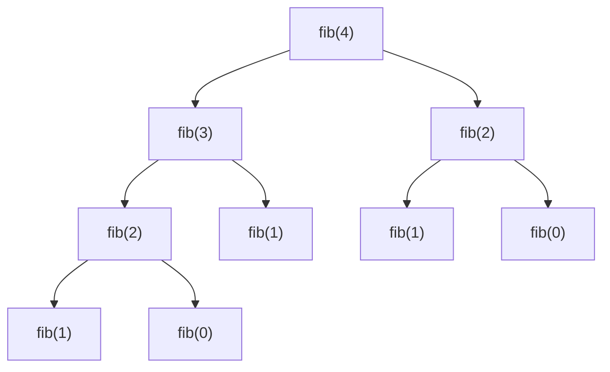

# Модуль 4 · Рекурсия глубже и QuickSort

## Что это и зачем

В модуле 3 рекурсия вызывала себя один раз. Здесь функция вызывает себя **дважды**, и задача делится пополам.
Этот приём называется «разделяй и властвуй». На нём построена быстрая сортировка QuickSort, которая заметно быстрее простых сортировок.

## 📖 Теория карточками

### 🃏 Фибоначчи: ветвящаяся рекурсия
Каждое число равно сумме двух предыдущих: 0, 1, 1, 2, 3, 5, 8…
В коде `fib(n) = fib(n-1) + fib(n-2)`: каждый вызов порождает ещё два. Получается дерево вызовов.



Видите, `fib(2)` посчитан дважды? Для больших `n` повторов огромное количество.

### 🃏 Разделяй и властвуй
Хотим найти максимум в списке. Делим его пополам, ищем максимум в каждой половине, берём большее.
Список из одного элемента: максимум — он сам (базовый случай).

### 🃏 QuickSort: «выбери опору и раздели»
1. Берём **опорный** элемент (у нас последний).
2. **Разбиваем** список (`partition`): слева всё не больше опоры, справа всё больше.
3. Опора уже стоит на своём месте. Так же сортируем левую и правую части.

### 🃏 Подвох
Если опора всегда оказывается самым большим (например, список уже отсортирован), деление выходит неровным: 0 элементов слева и почти весь список справа. Тогда QuickSort работает так же медленно, как простые сортировки: O(n²).
В среднем он работает за O(n log n).

## ✍️ Задания

Правьте `exercises.py`, запускайте `pytest m04-quicksort`. Пока в заготовке `raise NotImplementedError`, тест показывает «ещё не сделано».

**Задание 1. `fibonacci` и `count_fib_calls`.** Число Фибоначчи рекурсивно и подсчёт вызовов (для `n=5` их 15).

<details><summary>💡 Подсказка 1</summary>Базовых случая два: `F(0) = 0` и `F(1) = 1`. Оба можно объединить: для `n <= 1` ответ `n`.</details>
<details><summary>💡💡 Подсказка 2</summary>Для остальных `fibonacci(n - 1) + fibonacci(n - 2)`.</details>
<details><summary>💡💡💡 Подсказка 3</summary>Для `count_fib_calls`: при `n <= 1` вызов один; иначе `1 + count_fib_calls(n - 1) + count_fib_calls(n - 2)`.</details>

**Задание 2. `find_max_rec`.** Максимум «разделяй и властвуй», без `max()` и циклов.

<details><summary>💡 Подсказка 1</summary>Если `left == right`, в диапазоне один элемент, он и есть максимум.</details>
<details><summary>💡💡 Подсказка 2</summary>Найдите середину `mid = (left + right) // 2` и максимум в `[left, mid]` и в `[mid + 1, right]`.</details>
<details><summary>💡💡💡 Подсказка 3</summary>Верните большее из двух. Не забудьте выбросить `ValueError` для пустого списка и задать `right`, если он `None`.</details>

**Задание 3. `partition`.** Разбиение на месте (схема Ломуто).

<details><summary>💡 Подсказка 1</summary>Опора — `items[high]`. Заведите границу `boundary = low - 1`: до неё лежат «маленькие».</details>
<details><summary>💡💡 Подсказка 2</summary>Идите `j` от `low` до `high - 1`. Если `items[j] <= pivot`, сдвиньте границу и обменяйте `items[boundary]` с `items[j]`.</details>
<details><summary>💡💡💡 Подсказка 3</summary>В конце поставьте опору на место: обменяйте `items[boundary + 1]` и `items[high]` и верните `boundary + 1`.</details>

**Задание 4. `quicksort`.** Соберите всё вместе.

<details><summary>💡 Подсказка 1</summary>Сделайте копию списка и сортируйте её на месте. Для этого пригодится вспомогательная функция с границами `low` и `high`.</details>
<details><summary>💡💡 Подсказка 2</summary>Базовый случай: `low >= high`, в части не больше одного элемента.</details>
<details><summary>💡💡💡 Подсказка 3</summary>`p = partition(items, low, high)`, затем отсортируйте `[low, p - 1]` и `[p + 1, high]`.</details>

**Задание 5. «Найди ошибку».** `quicksort_lists` иногда теряет элементы. Исправьте её.

<details><summary>💡 Подсказка 1</summary>Попробуйте список с одинаковыми числами, например `[2, 2, 2]`.</details>
<details><summary>💡💡 Подсказка 2</summary>Куда попадают элементы, равные опорному?</details>
<details><summary>💡💡💡 Подсказка 3</summary>В списке `larger` условие `x > pivot` отбрасывает равные. Нужно `x >= pivot`.</details>

**Задание 6. Предскажи вывод (без запуска).** Что вернёт `partition([3, 1, 2], 0, 2)` и каким станет список?

<details><summary>Ответ</summary>Вернёт `1`, список станет `[1, 2, 3]`. Опора 2: число 3 больше, остаётся; 1 меньше, меняется с 3 → `[1, 3, 2]`; затем опора ставится на место `1`: `[1, 2, 3]`.</details>

## 🏁 Покажи, что получилось

```bash
python m04-quicksort/demo.py
```

Покажет дерево вызовов Фибоначчи, рост числа вызовов, скорость QuickSort и подвох с отсортированным списком.

## 🧠 А знаете?

Тони Хоар придумал QuickSort в 1959–1960 годах, когда учился в МГУ и занимался машинным переводом: нужно было быстро искать слова в словаре.
Подробнее: [Tony Hoare, Wikipedia](https://en.wikipedia.org/wiki/Tony_Hoare), [профиль Хоара в Оксфорде](https://www.cs.ox.ac.uk/people/tony.hoare).
