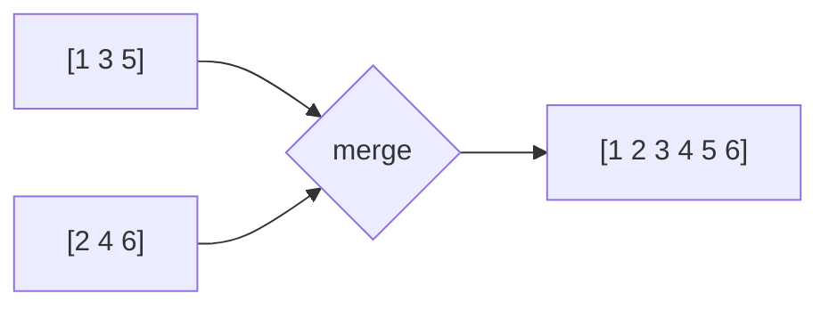

# Модуль 5 · Очередь и MergeSort

> Незнакомое слово? Загляните в [глоссарий](../docs/GLOSSARY.md).

## Что это и зачем

Очередь — как в кофейне: кто первым встал, того первым и обслужат. Её используют для задач, сообщений, печати и обхода графов.
Сортировка слиянием — быстрый и надёжный способ сортировать, основанный на простой идее: слить две отсортированные стопки в одну.

## 📖 Теория карточками

### 🃏 Очередь: кофейня
Новый человек встаёт **в конец**, обслуживают того, кто **в начале**. Это **FIFO**: первым пришёл — первым ушёл.
Операции: `enqueue` (встать), `dequeue` (уйти с начала), `peek` (посмотреть первого), `is_empty`, `size`.

Не путайте со стеком из модуля 3: там последний пришёл — первым ушёл.

### 🃏 Почему `deque`, а не список
`list.pop(0)` убирает первый элемент и сдвигает **все остальные** на шаг влево, это медленно на больших списках.
`collections.deque` умеет убирать элемент с начала мгновенно (`popleft()`). Для очереди это идеальный выбор.

### 🃏 Две отсортированные стопки
У вас две стопки карточек, в каждой карточки лежат по порядку. Смотрим на верхние карточки обеих стопок и берём меньшую в новую стопку. Так до конца. Это `merge`.



### 🃏 MergeSort
1. Делим список пополам.
2. Сортируем каждую половину (тем же способом, это рекурсия).
3. Сливаем две отсортированные половины.

Список из одного элемента уже отсортирован (базовый случай). MergeSort всегда работает за O(n log n), без неприятных сюрпризов QuickSort.

## ✍️ Задания

Правьте `exercises.py`, запускайте `pytest m05-queue-mergesort`. Пока в заготовке `raise NotImplementedError`, тест показывает «ещё не сделано».

**Задание 1. Класс `Queue`.** Очередь на основе `deque`.

<details><summary>💡 Подсказка 1</summary>В `__init__` создайте пустой `deque`: `from collections import deque`.</details>
<details><summary>💡💡 Подсказка 2</summary>`enqueue` — это `append`, `dequeue` — это `popleft()`. Первый элемент очереди — `self._items[0]`.</details>
<details><summary>💡💡💡 Подсказка 3</summary>В `dequeue` и `peek` сначала проверьте `if self.is_empty():` и выбросьте `IndexError("Очередь пуста")`.</details>

**Задание 2. `simulate_tasks`.** Задачи выполняются по очереди, по одной. Верните, когда завершилась каждая.

<details><summary>💡 Подсказка 1</summary>Положите все задачи в `Queue`, затем снимайте по одной, пока очередь не опустеет.</details>
<details><summary>💡💡 Подсказка 2</summary>Заведите `current_time = 0`. Каждая задача — пара `(название, длительность)`.</details>
<details><summary>💡💡💡 Подсказка 3</summary>`name, duration = queue.dequeue()`, затем `current_time += duration`, и добавьте `(name, current_time)` в результат.</details>

**Задание 3. `merge`.** Слить два отсортированных списка.

<details><summary>💡 Подсказка 1</summary>Нужны два указателя `i` и `j`: по одному на каждый список.</details>
<details><summary>💡💡 Подсказка 2</summary>Пока в обоих списках есть элементы, берите меньший из `left[i]` и `right[j]` и сдвигайте соответствующий указатель.</details>
<details><summary>💡💡💡 Подсказка 3</summary>Когда один список закончился, допишите «хвост» другого: `result.extend(left[i:])` и `result.extend(right[j:])`.</details>

**Задание 4. `merge_sort`.** Соберите сортировку слиянием.

<details><summary>💡 Подсказка 1</summary>Базовый случай: список из 0 или 1 элемента уже отсортирован (верните копию).</details>
<details><summary>💡💡 Подсказка 2</summary>Найдите середину `mid = len(items) // 2` и разрежьте на `items[:mid]` и `items[mid:]`.</details>
<details><summary>💡💡💡 Подсказка 3</summary>`return merge(merge_sort(items[:mid]), merge_sort(items[mid:]))`.</details>

**Задание 5. «Найди ошибку».** `sort_by_halves` иногда теряет элементы. Исправьте её.

<details><summary>💡 Подсказка 1</summary>Проверьте на списке из двух или трёх элементов.</details>
<details><summary>💡💡 Подсказка 2</summary>Посчитайте элементы: левая половина плюс правая должны равняться всему списку.</details>
<details><summary>💡💡💡 Подсказка 3</summary>Правая половина начинается с `items[mid + 1:]`, то есть элемент в позиции `mid` пропущен. Нужно `items[mid:]`.</details>

**Задание 6. Предскажи вывод (без запуска).** В очереди `[A, B, C]` выполнили `enqueue("D")`, затем два раза `dequeue()`. Что осталось в очереди и что вернёт `peek()`?

<details><summary>Ответ</summary>Осталось `[C, D]`, `peek()` вернёт `"C"`. Первыми ушли A и B, потому что пришли раньше всех.</details>

## 🏁 Покажи, что получилось

```bash
python m05-queue-mergesort/demo.py
```

Покажет очередь, обработку задач, сравнение MergeSort с пузырьком и разницу между `deque.popleft()` и `list.pop(0)`.

## 🧠 А знаете?

Идею сортировки слиянием приписывают Джону фон Нейману, ещё в 1945 году, в самом начале эпохи компьютеров.
Подробнее: [Merge sort, Wikipedia](https://en.wikipedia.org/wiki/Merge_sort).
