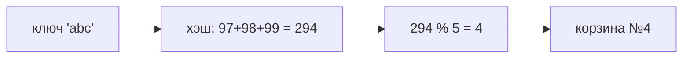

# Модуль 6 · Хэш-таблицы

## Что это и зачем

Хэш-таблица позволяет находить значение по ключу почти мгновенно, не перебирая всё подряд.
Именно так устроен `dict` в Python. Знать, как он работает внутри, полезно и для собеседований, и для понимания, почему словари такие быстрые.

## 📖 Теория карточками

### 🃏 Шкафчики в раздевалке
Представьте шкафчики с номерами. Хотите положить куртку «Анны»: превращаете имя в число и кладёте в шкафчик с этим номером.
Через неделю не нужно проверять все шкафчики, достаточно снова посчитать номер по имени.

### 🃏 Хэш-функция
Это правило, которое превращает ключ в число. У нас простое: **сумма кодов символов** (`ord`).
Номер корзины = `хэш % capacity` (остаток от деления на число корзин).



### 🃏 Коллизии
А если два ключа попали в один шкафчик? `abc` и `cba` дают одинаковую сумму: **коллизия**.
Самый простой выход: в каждой корзине храним **список пар** (цепочку). Чтобы найти ключ, смотрим только внутри одной корзины.

### 🃏 `resize`: когда тесно
Чем больше ключей на корзину, тем длиннее цепочки и тем медленнее поиск.
Тогда таблицу **увеличивают вдвое** и раскладывают все пары заново. Нельзя просто скопировать корзины: номер зависит от `capacity`, а он изменился.

## ✍️ Задания

Правьте `exercises.py`, запускайте `pytest m06-hash-tables`. Пока в заготовке `raise NotImplementedError`, тест показывает «ещё не сделано».

**Задание 1. `string_hash`.** Хэш строки как сумма кодов символов.

<details><summary>💡 Подсказка 1</summary>Код символа возвращает `ord("a")`, это 97.</details>
<details><summary>💡💡 Подсказка 2</summary>Пройдите по строке циклом и копите сумму. Пустая строка даёт 0.</details>
<details><summary>💡💡💡 Подсказка 3</summary>`total = 0`, `for char in text: total += ord(char)`, `return total`.</details>

**Задание 2. `find_collisions`.** Найдите ключи, попавшие в одну корзину.

<details><summary>💡 Подсказка 1</summary>Разложите ключи по словарю «номер корзины → список ключей».</details>
<details><summary>💡💡 Подсказка 2</summary>Номер корзины: `string_hash(key) % capacity`. Удобно `buckets.setdefault(номер, []).append(key)`.</details>
<details><summary>💡💡💡 Подсказка 3</summary>В ответ возьмите только корзины, где `len(группа) > 1`.</details>

**Задание 3. `HashTable.insert` и `search`.** Добавление, обновление и поиск.

<details><summary>💡 Подсказка 1</summary>В `__init__` нужны `capacity`, `size = 0` и `table` из `capacity` пустых списков.</details>
<details><summary>💡💡 Подсказка 2</summary>В `insert` найдите корзину и пройдите по её парам: если ключ уже есть, замените пару и выйдите (`return`) без увеличения `size`.</details>
<details><summary>💡💡💡 Подсказка 3</summary>Если ключа нет, добавьте `(key, value)` в корзину и сделайте `self.size += 1`. `search` ищет ключ в той же корзине, иначе возвращает `None`.</details>

**Задание 4. `delete` и `resize`.** Удаление и увеличение таблицы.

<details><summary>💡 Подсказка 1</summary>`delete` ищет пару в корзине, как `search`. Нашли — удаляем и возвращаем `True`.</details>
<details><summary>💡💡 Подсказка 2</summary>После удаления не забудьте `self.size -= 1`. Если пары не нашли — `False`.</details>
<details><summary>💡💡💡 Подсказка 3</summary>`resize`: сохраните старую таблицу, удвойте `capacity`, создайте новую пустую, обнулите `size` и вставьте все старые пары через `insert`.</details>

**Задание 5. «Найди ошибку».** Функция `put` иногда хранит один ключ дважды. Исправьте её.

<details><summary>💡 Подсказка 1</summary>Положите один и тот же ключ дважды и посмотрите, что лежит в корзинах.</details>
<details><summary>💡💡 Подсказка 2</summary>Что делает функция после того, как обновила найденную пару?</details>
<details><summary>💡💡💡 Подсказка 3</summary>После обновления нужно сразу выйти: добавьте `return` внутри `if`.</details>

**Задание 6. Предскажи вывод (без запуска).** В какую корзину попадёт ключ `"abc"` в таблицу из 5 корзин?

<details><summary>Ответ</summary>В корзину №4. Хэш `97 + 98 + 99 = 294`, а `294 % 5 = 4`. В ту же корзину попадёт и `"cba"`: это коллизия.</details>

## 🏁 Покажи, что получилось

```bash
python m06-hash-tables/demo.py
```

Покажет хэши строк, корзины до и после `resize`, коллизии и разницу между поиском в списке и в `dict`.

## 🧠 А знаете?

Встроенная функция `hash()` для строк в Python **меняет результат при каждом запуске программы**. Так сделано намеренно: чтобы нельзя было подобрать данные, которые создадут много коллизий и замедлят словарь.
Поэтому в нашем задании своя, предсказуемая хэш-функция.
Подробнее: [PYTHONHASHSEED в документации Python](https://docs.python.org/3/using/cmdline.html#envvar-PYTHONHASHSEED), [скорость операций над `dict`](https://wiki.python.org/moin/TimeComplexity).
