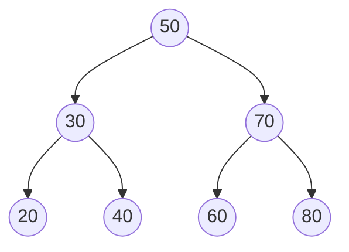
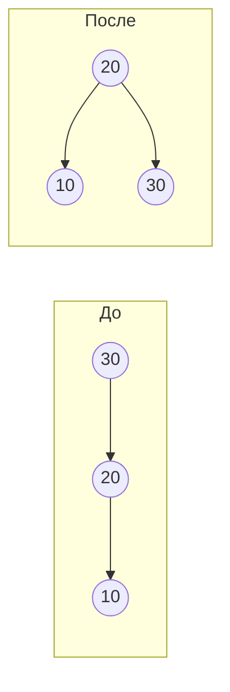

# Модуль 7 · Деревья

## Что это и зачем

Дерево — это структура, где каждый элемент (узел) может иметь «детей». Так устроены папки на диске, оглавления, генеалогические древа.
Особое **дерево поиска** позволяет искать значение так же быстро, как бинарный поиск, но при этом легко добавлять новые элементы.

## 📖 Теория карточками

### 🃏 Игра «больше/меньше»
Загадали число. На каждом шаге вам говорят «больше» или «меньше» и вы идёте влево или вправо.
Бинарное дерево поиска (**BST**) устроено так: **слева всегда меньшие**, **справа большие**. Поэтому поиск похож на эту игру.



### 🃏 Как обойти дерево
- **В глубину (DFS)**: уходим вниз до конца, потом возвращаемся. Три порядка:
  - прямой: корень → левое → правое;
  - симметричный: левое → корень → правое (в BST даёт числа **по возрастанию**);
  - обратный: левое → правое → корень.
- **В ширину (BFS)**: по этажам, слева направо. Нужна очередь (модуль 5).

### 🃏 Беда: дерево вытянулось
Если добавлять числа 1, 2, 3, 4… по порядку, дерево превратится в цепочку и поиск станет медленным, как перебор.

### 🃏 AVL: дерево, которое держит баланс
У каждого узла считаем **баланс**: высота левого поддерева минус высота правого. Если он вышел за пределы от −1 до 1, дерево **поворачивают**.
Правый поворот поднимает левого потомка на место родителя, а родитель становится его правым потомком:



Четыре случая: лево-лево (правый поворот), право-право (левый поворот), лево-право и право-лево (сначала поворот у потомка, потом у узла).

## ✍️ Задания

Правьте `exercises.py`, запускайте `pytest m07-trees`. Класс `Node` уже готов. Пока в заготовке `raise NotImplementedError`, тест показывает «ещё не сделано».

**Задание 1. `BST.insert` и `search`.** Добавление и поиск в дереве поиска.

<details><summary>💡 Подсказка 1</summary>Рекурсия: пустое место (`None`) — сюда и нужно положить новый `Node`.</details>
<details><summary>💡💡 Подсказка 2</summary>Меньше текущего — идём в `node.left`, больше — в `node.right`, равно — ничего не делаем (дубликаты не нужны).</details>
<details><summary>💡💡💡 Подсказка 3</summary>Помощница `_insert(node, value)` возвращает узел: `node.left = self._insert(node.left, value)`, а в `insert` — `self.root = self._insert(self.root, value)`. Поиск можно сделать циклом `while`.</details>

**Задание 2. Обходы в глубину:** `preorder`, `inorder`, `postorder`.

<details><summary>💡 Подсказка 1</summary>Пустое место (`None`) — базовый случай: верните `[]`.</details>
<details><summary>💡💡 Подсказка 2</summary>Все три отличаются только порядком трёх частей: значение узла, обход левого, обход правого.</details>
<details><summary>💡💡💡 Подсказка 3</summary>Для `inorder`: `[*inorder(root.left), root.value, *inorder(root.right)]`.</details>

**Задание 3. `bfs`.** Обход в ширину через очередь.

<details><summary>💡 Подсказка 1</summary>Положите корень в очередь `deque([root])`.</details>
<details><summary>💡💡 Подсказка 2</summary>Пока очередь не пуста: снимите узел слева (`popleft`), запишите его значение.</details>
<details><summary>💡💡💡 Подсказка 3</summary>Затем поставьте в очередь его левого и правого потомков (если они есть).</details>

**Задание 4. `height`, `update_height`, `balance_factor`.** Три маленьких помощника для AVL.

<details><summary>💡 Подсказка 1</summary>У пустого места (`None`) высота 0, иначе берём `node.height`.</details>
<details><summary>💡💡 Подсказка 2</summary>Высота узла = 1 + большая из высот потомков: `1 + max(height(left), height(right))`.</details>
<details><summary>💡💡💡 Подсказка 3</summary>Баланс: `height(node.left) - height(node.right)`. Для `None` ответ 0.</details>

**Задание 5. `right_rotate` и `left_rotate`.** Повороты.

<details><summary>💡 Подсказка 1</summary>Для правого поворота: `y = z.left` — он станет новым корнем. Запомните `t3 = y.right`.</details>
<details><summary>💡💡 Подсказка 2</summary>Перекиньте связи: `y.right = z`, `z.left = t3`.</details>
<details><summary>💡💡💡 Подсказка 3</summary>Обновите высоты: сначала `z` (теперь он ниже), потом `y`. Верните `y`. Левый поворот зеркален.</details>

**Задание 6. `rebalance` и `AVLTree.insert`.** Сборка самобалансирующегося дерева.

<details><summary>💡 Подсказка 1</summary>`rebalance`: обновите высоту узла и посчитайте баланс.</details>
<details><summary>💡💡 Подсказка 2</summary>Баланс больше 1: если у левого потомка баланс меньше 0, сначала `node.left = left_rotate(node.left)`; затем `right_rotate(node)`. Баланс меньше −1: зеркально.</details>
<details><summary>💡💡💡 Подсказка 3</summary>`insert` — та же рекурсия, что в BST, но на выходе из каждого узла возвращайте `rebalance(node)`.</details>

**Задание 7. «Найди ошибку».** `contains_value` иногда не находит существующие значения. Исправьте её.

<details><summary>💡 Подсказка 1</summary>Попробуйте найти в дереве из модуля число 20 или 60.</details>
<details><summary>💡💡 Подсказка 2</summary>Проверьте, в какую сторону функция идёт, когда искомое меньше текущего.</details>
<details><summary>💡💡💡 Подсказка 3</summary>Если `target < root.value`, нужно идти в `root.left`. Направления перепутаны.</details>

**Задание 8. Предскажи вывод (без запуска).** Вставили в BST числа `50, 30, 70, 20, 40`. Что вернёт симметричный обход (`inorder`)?

<details><summary>Ответ</summary>`[20, 30, 40, 50, 70]`. Симметричный обход дерева поиска всегда выдаёт числа по возрастанию.</details>

## 🏁 Покажи, что получилось

```bash
python m07-trees/demo.py
```

Нарисует дерево, покажет все обходы и сравнит высоту обычного BST и AVL после вставки чисел по порядку.

## 🧠 А знаете?

АВЛ-дерево придумали в 1962 году советские математики Георгий Адельсон-Вельский и Евгений Ландис. Это первое в истории самобалансирующееся дерево поиска.
Название «AVL» составлено из первых букв их фамилий.
Подробнее: [AVL tree, Wikipedia](https://en.wikipedia.org/wiki/AVL_tree).
