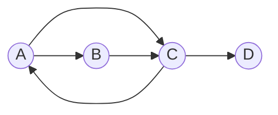

# Модуль 8 · Графы

## Что это и зачем

Граф — это точки (**вершины**) и линии между ними (**рёбра**). Карта метро, дружба в соцсети, дороги между городами, ссылки между страницами: всё это графы.
Дерево из прошлого модуля — частный случай графа. Графы нужны, чтобы находить пути и связи.

## 📖 Теория карточками

### 🃏 Карта метро
Станции — вершины, перегоны — рёбра. Если поезд идёт только в одну сторону, ребро **ориентированное**: из A в B можно, обратно нельзя.



### 🃏 Как хранить граф: список смежности
Для каждой вершины храним список её соседей. В Python это словарь:

```python
{"A": ["B", "C"], "B": ["C"], "C": ["A", "D"], "D": []}
```

Мало места и удобно перебирать соседей.

### 🃏 Как хранить граф: матрица смежности
Таблица «кто с кем связан». Единица в строке `A`, столбце `B` значит «есть ребро из A в B».

```
    A  B  C  D
A   0  1  1  0
B   0  0  1  0
C   1  0  0  1
D   0  0  0  0
```

Спросить «есть ли ребро A→B» можно мгновенно, но таблица занимает много места: n × n клеток.

### 🃏 BFS: волны на воде
Бросили камень в воду: сначала круг вокруг, потом дальше. BFS (обход в ширину) идёт так же: сначала соседи, потом соседи соседей. Нужна **очередь** и множество **visited**, чтобы не ходить по кругу.
Благодаря «волнам» BFS находит путь с наименьшим числом рёбер (пересадок).

## ✍️ Задания

Правьте `exercises.py`, запускайте `pytest m08-graphs`. Пока в заготовке `raise NotImplementedError`, тест показывает «ещё не сделано».

**Задание 1. `DirectedGraph`.** Граф на списке смежности.

<details><summary>💡 Подсказка 1</summary>В `__init__` заведите пустой словарь `self.adjacency_list = {}`.</details>
<details><summary>💡💡 Подсказка 2</summary>`add_vertex`: если вершины ещё нет в словаре, положите для неё пустой список.</details>
<details><summary>💡💡💡 Подсказка 3</summary>`add_edge`: сначала `add_vertex` для обеих вершин, потом добавьте `to_vertex` в список соседей `from_vertex` (если его там ещё нет). `get_neighbors` может использовать `dict.get(vertex, [])`.</details>

**Задание 2. `bfs`.** Обход в ширину.

<details><summary>💡 Подсказка 1</summary>Если стартовой вершины нет в графе, верните `[]`.</details>
<details><summary>💡💡 Подсказка 2</summary>Заведите очередь `deque([start])` и множество `visited = {start}`.</details>
<details><summary>💡💡💡 Подсказка 3</summary>Пока очередь не пуста: снимите вершину, запишите её, а каждого соседа, которого нет в `visited`, отметьте и поставьте в очередь.</details>

**Задание 3. `AdjacencyMatrixGraph` и `edges_to_adjacency_matrix`.** Граф на матрице.

<details><summary>💡 Подсказка 1</summary>Храните `self.vertices` (список названий) и `self.matrix` (список строк-списков).</details>
<details><summary>💡💡 Подсказка 2</summary>Новая вершина: во все существующие строки добавьте `0` справа, потом добавьте новую строку из нулей длиной `len(vertices)`.</details>
<details><summary>💡💡💡 Подсказка 3</summary>Ребро: найдите индексы вершин (`self.vertices.index(...)`) и поставьте `1` в `matrix[i][j]`. `edges_to_adjacency_matrix` просто вызывает `add_edge` для каждой пары.</details>

**Задание 4. `shortest_path_length`.** Сколько пересадок до нужной станции.

<details><summary>💡 Подсказка 1</summary>Подойдёт BFS: он идёт «волнами», первая волна — расстояние 1, вторая — 2.</details>
<details><summary>💡💡 Подсказка 2</summary>Вместо `visited` ведите словарь `distance`: `distance[start] = 0`.</details>
<details><summary>💡💡💡 Подсказка 3</summary>Для нового соседа: `distance[neighbor] = distance[current] + 1`. Дошли до `goal` — верните его расстояние. Очередь опустела — `-1`.</details>

**Задание 5. «Найди ошибку».** `has_path` на графе с циклом уходит в `RecursionError`. Исправьте её.

<details><summary>💡 Подсказка 1</summary>Попробуйте граф `{"A": ["B"], "B": ["A"]}` и поиск пути из `A` в `X`.</details>
<details><summary>💡💡 Подсказка 2</summary>Функция принимает множество `visited`, но что она в него кладёт?</details>
<details><summary>💡💡💡 Подсказка 3</summary>Перед обходом соседей добавьте текущую вершину: `visited.add(start)`.</details>

**Задание 6. Предскажи вывод (без запуска).** Граф: `A→B`, `A→C`, `B→D`, `C→D`. Что вернёт `bfs(graph, "A")`?

<details><summary>Ответ</summary>`["A", "B", "C", "D"]`. Вершина `D` достижима двумя путями, но благодаря `visited` посещается один раз.</details>

## 🏁 Покажи, что получилось

```bash
python m08-graphs/demo.py
```

Покажет карту метро, обход BFS, число пересадок и матрицу смежности.

## 🧠 А знаете?

В 1959 году Эдвард Мур заново придумал обход в ширину, чтобы найти кратчайший выход из лабиринта. Позже его метод применили для прокладки проводов на микросхемах.
Подробнее: [Breadth-first search, Wikipedia](https://en.wikipedia.org/wiki/Breadth-first_search).
